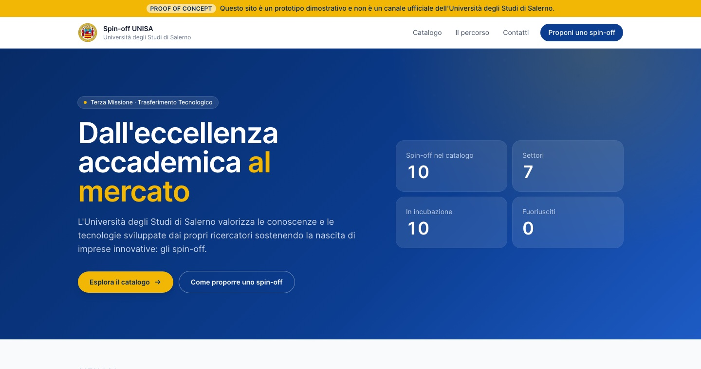
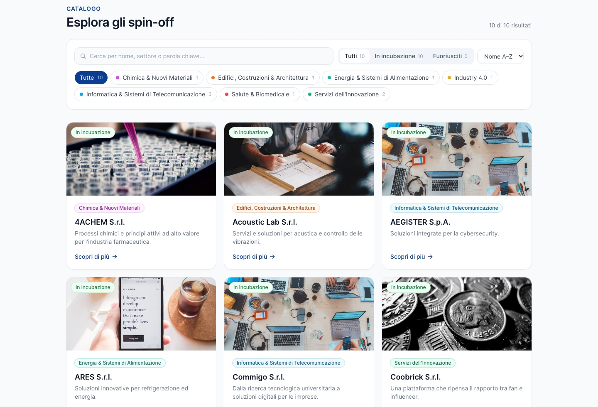
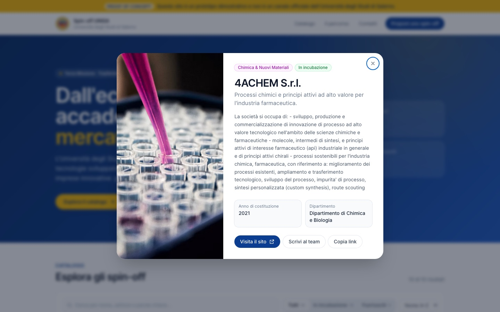

<h1 align="center">UNISA Spin-off Showcase</h1>

<p align="center">
  <b>A proof-of-concept redesign of the University of Salerno spin-off page: a searchable, filterable catalogue that presents research-born companies the way a modern startup portal would.</b>
</p>

<p align="center">
  <a href="https://vincenzo-esposit0.github.io/Unisa-SpinOffs/"><b>🌐 Live demo</b></a> ·
  <a href="#features"><b>✨ Features</b></a> ·
  <a href="#run-it-locally"><b>⚙️ Run locally</b></a>
</p>

<p align="center">
  
</p>

> [!NOTE]
> This is an independent proof of concept, not an official website of the University of Salerno. Names and logos belong to their respective owners.

---

## At a glance

| | |
|---|---|
| **What it is** | A redesign proposal for the university's spin-off listing, built as a working prototype rather than a mock-up |
| **Goal** | Make the university's spin-offs easier to explore and better presented, with search, filters and a full sheet for each company |
| **My role** | Sole author: analysis of the existing page, UX and visual design, front-end development, data preparation and deployment |
| **Stack** | React 18 · TypeScript · Vite 5 · Tailwind CSS 3 · GitHub Actions · GitHub Pages |
| **Content** | 10 incubated spin-offs in 7 sectors, loaded from a JSON catalogue |

## Design goals

1. **Findable.** A visitor, investor or company should reach the right spin-off in a few seconds, through search, sector and status.
2. **Credible.** Use the university's colours (blue `#0B3D91`, gold `#F2B705`), clean typography and consistent cards, so that each company looks like a real product.
3. **Actionable.** Every company sheet leads somewhere: the company's website, the team's email, or a link to share.
4. **Explanatory.** Explain how a spin-off is created, so that researchers know how to start one.

## Features

### Catalogue with search and filters
- **Full-text search** over name, tagline, description, sector and department.
- **Sector filter** with live counts, and an **incubation status** filter (in incubation / graduated).
- **Sorting** A→Z, Z→A or by most recent founding year, plus a live result count.
- **Feedback states:** a loading skeleton, and an empty state with a one-click reset.



### Company sheet
- **Contents:** the full description, founding year and department.
- **Actions:** visit the website, email the team, copy the link.
- **Shareable link:** each sheet has its own URL (`?s=<id>`), so it can be opened or shared directly.
- **Keyboard:** <kbd>Esc</kbd> closes the sheet.



### Around the catalogue
- **How a spin-off is born:** the four steps from research idea to company, with the role of the Technology Transfer Office and the Spin-off Committee.
- **Key figures** at the top: companies, sectors, in incubation, graduated.
- **Contacts** and a call to action to propose a spin-off.
- A visible **proof-of-concept banner**, so the prototype is never mistaken for the official site.
- **Responsive** from mobile to desktop.

## Engineering notes

- **Data-driven.** All content lives in [`public/unisa-spinoffs.json`](public/unisa-spinoffs.json). Updating the catalogue needs no code changes. Every entry is normalised on load (trimmed fields, safe defaults, validated year).
- **Resilient.** If the JSON can't be loaded, the app falls back to a built-in demo dataset instead of showing an empty page.
- **Static and portable.** No backend: `npm run build` produces a `dist/` folder, which GitHub Actions deploys to GitHub Pages on every push.
- **Cover images** come from Unsplash and are chosen by sector.

## Run it locally

Requirements: Node.js 18 or later (20 recommended).

```bash
npm install
npm run dev        # http://localhost:5173
npm run build      # production build in dist/
npm run preview
```

### Updating the catalogue

Edit `public/unisa-spinoffs.json`. Each entry looks like this:

```json
{
  "id": "string",
  "name": "string",
  "category": "string",
  "incubatorStatus": "Incubazione | Fuoriusciti",
  "tagline": "string",
  "description": "string",
  "founded": 2020,
  "department": "string",
  "website": "https://...",
  "email": "contatto@...",
  "image": "https://..."
}
```

## License

Copyright © 2026 Vincenzo Esposito. All rights reserved. This repository is proprietary: unauthorized copying, distribution or modification is prohibited. See [LICENSE](LICENSE).

---

<sub>Vincenzo Esposito · <a href="https://vincenzo-esposit0.github.io/">Website</a> · <a href="https://www.linkedin.com/in/vincenzo-e">LinkedIn</a></sub>
